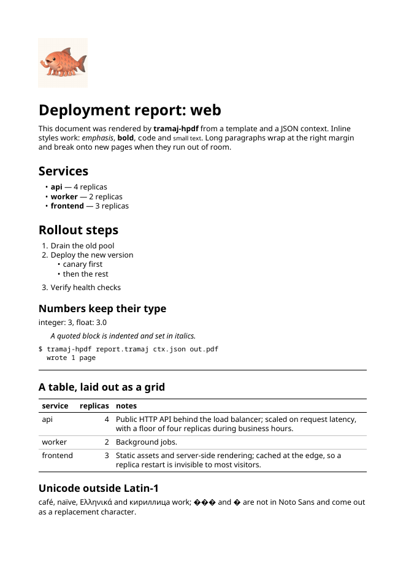
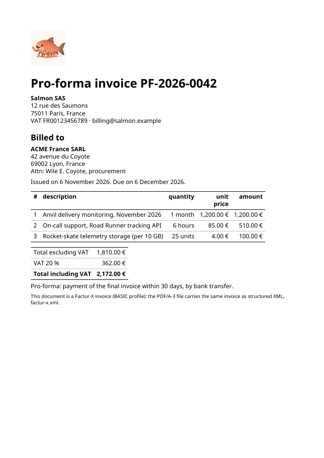

# tramaj-hpdf

Folds an evaluated `tramaj-hs` `Node` into a PDF document with
[HPDF](https://hackage.haskell.org/package/HPDF). The print counterpart of
`tramaj-react` and `tramaj-halogen`: the evaluator produces the tree, this
package decides what it looks like on a page.

## Use

```haskell
import qualified Data.ByteString.Lazy as BL
import Tramaj.Hpdf

main = do
  fonts <- loadFonts
  Right images <- loadImages "." node
  BL.writeFile "out.pdf" (renderPdf fonts images defaultOptions node)
```

`renderPdfToFile path opts node` does all three. `Options` sets the page
size and margins (`a4` by default), the document's author and subject,
whether page streams are compressed, and the directory a relative
`img src` is read from (`optBaseDir`; the CLI uses the template's).

The CLI renders a template against a context, or an already-evaluated node
in the normative Node JSON (`specs/node-json.md`):

```
cabal run tramaj-hpdf -- template.tramaj context.json out.pdf
cabal run tramaj-hpdf -- --node node.json out.pdf
```

## Example

[`examples/report/`](examples/report/) renders a deployment report from a
template and a JSON context ([`report.pdf`](examples/report/report.pdf)):



## Factur-X invoices (PDF/A-3b)

With the HPDF fork (below), `optArchive = Just (facturX icc level xml)`
writes the document as PDF/A-3b: XMP metadata, an sRGB output intent, the
XML attached as `factur-x.xml` (`/AFRelationship /Alternative`) and the
Factur-X XMP properties at that level (`BASIC`, `EN 16931`…). It needs the
TrueType fonts: `renderPdfE` refuses a PDF/A document set in the standard 14
fonts, which are not embedded.

`Tramaj.Hpdf.Xml.renderXml` writes an evaluated node as XML, so the invoice's
XML comes from a tramaj template over the same context as the page. A tag
has no `:`, so a namespace prefix is written with a `-`: `ram-ID` becomes
`ram:ID` when an `xmlns:ram` attribute is in scope. The CLI:

```
cabal run tramaj-hpdf -- --fonts /usr/share/fonts/truetype/noto \
  --factur-x factur-x.tramaj [--factur-x-level BASIC] [--icc sRGB.icc] [--xml-out factur-x.xml] \
  invoice.tramaj invoice.json invoice.pdf
cabal run tramaj-hpdf -- --xml factur-x.tramaj invoice.json factur-x.xml
```

`--factur-x-xml FILE` attaches an XML file as it is. The ICC profile
defaults to colord's sRGB (`/usr/share/color/icc/colord/sRGB.icc`, CC0-1.0,
an ICC v4 profile); none is shipped with this package. See
[`examples/invoice/`](examples/invoice/): a pro-forma invoice, BASIC profile.



Checked so far with qpdf (through pikepdf), pdfinfo, pdffonts and
pdfdetach: the structure, the XMP fields, the embedded fonts and the
attachment. Not yet run through veraPDF or Mustang, nor the XML through
the Factur-X XSD and Schematron.

## What a node becomes

`Tramaj.Hpdf.Layout` is pure: `nodeBlocks` reads the tree as a document and
`layoutPages` breaks it into lines and pages, given font widths. It can be
tested, or drawn by another backend, without HPDF.

- `h1`–`h6`: bold headings, 22pt down to 11pt.
- `p`, `pre`, `blockquote`, `ul`, `ol`, `li`, `hr`: paragraphs, preformatted
  Courier text, indented quotes, bulleted and numbered lists (a fragment
  inside a list, as `map` makes, is looked through), and rules.
- `strong`/`b`, `em`/`i`, `code`/`kbd`/`samp`, `small`/`sub`/`sup` and the
  other inline tags in `inlineTags` style text within its paragraph; `br`
  breaks the line.
- `table`: a grid. Rows are the `tr` children (directly or in `thead`,
  `tbody`, `tfoot`), cells their `td`/`th`. The header is the `thead` rows,
  or else the leading rows made only of `th`; `th` is bold. Columns are as
  wide as their content when the table fits the text width; otherwise each
  gets its longest word and the rest of the width is shared by need, and
  cells wrap. A cell holding a number is right-aligned, `align: "left" |
  "center" | "right"` sets it, and a header cell follows its column. Heavy
  rules frame the table and the header, light ones separate body rows. A
  table breaks between rows, and the header is repeated at the top of each
  new page. A `caption` (and anything else that is not a row) is laid out
  above the table. A cell shows text only: nested lists, rules, images and
  tables inside it are flattened to their text.
- `img`: an image on a line of its own, from `src` (a file path, relative
  to `optBaseDir`; not a URL). `width` and `height` are in points (a number,
  or `"72"`, `"72pt"`, `"72px"`); with one of them the other keeps the
  aspect ratio, and with neither the image is its pixel size, shrunk to
  the text width. `align` places it left, center or right. JPEG is embedded
  as is; PNG and the other formats JuicyPixels reads are decoded to RGB,
  with transparency flattened onto white. An image the layout has no size
  for shows its `alt` text, or `[image: src]`; `renderPdfToFile` fails
  instead, naming the `src` it could not read.
- Any other tag is a plain block container, so its content still shows.
- A fragment contributes its children. Text directly inside a container is
  gathered into paragraphs between its block siblings.
- Values render as `str` writes them: an integer as its digits, a float
  always with a fraction (`3.0`). An element with a value slot and no
  children shows the value, as `tramaj-react` does.
- Other attributes, and actions, are ignored: a page has nothing to wire an
  action to.

Lines wrap greedily at spaces; a word wider than the line is cut by
character; `pre` keeps its spaces and breaks at newlines.

## Limits, and what an HPDF fork would add

Upstream HPDF writes only the PDF standard 14 fonts, which the viewer
supplies, with a single-byte encoding (MacRoman). So:

- **No Unicode beyond Western European Latin.** A character the encoding
  lacks (CJK, Greek, Cyrillic, most symbols) is drawn as `?`.
- **No font embedding.** The output depends on the viewer's Helvetica and
  Courier.
- **Not PDF/A.** PDF/A requires every font embedded, plus XMP metadata and
  an output intent.

Lifting these needs changes inside HPDF itself: loading a TrueType/OpenType
font, embedding it as a CIDFontType2 with Identity-H encoding, a
`ToUnicode` CMap so text can be copied out, subsetting to keep files small,
and the PDF/A metadata objects. That is a fork of HPDF (or patches sent
upstream), not something this package can do from outside; `fontMetrics`
and `Metrics.encodable` are where such fonts would plug in.

**Proof of concept, on an HPDF fork.** On this branch, `cabal.project`
pins an HPDF fork (https://github.com/lucasdicioccio/HPDF, branch
`factur-x`, built on `unicode-truetype`, not yet proposed upstream) that embeds TrueType fonts
as Type0/CIDFontType2 with Identity-H and a `ToUnicode` CMap, as a subset
holding only the glyphs the document shows (`ABCDEF+` tagged).
`loadTrueTypeFonts (notoSans dir)` (or `tramaj-hpdf --fonts DIR …`) draws
the six faces in Noto Sans, embedding only the faces a document uses, so
Cyrillic, Greek and accented Latin render and copy out; the example in
`examples/cyrillic` comes to about 45 KB with five faces. Still missing:
kerning and shaping for complex scripts. PDF/A-3b and Factur-X are above.

Also not done yet: links (`a href` as a link annotation), `colspan` and
`rowspan`, a table row taller than a page (it overflows instead of
splitting), images inline in text or in table cells, the v3 symbol and
term labels `tramaj-react` shows, and page headers/footers.

## Tests

```
cabal test hpdf --enable-tests
```

Layout tests use a fixed-width fake font; the HPDF tests check widths,
encodability, the page count and the content stream; and every node in the
conformance corpus (`corpus/cases/*/expected.json`) must fold to a PDF.
