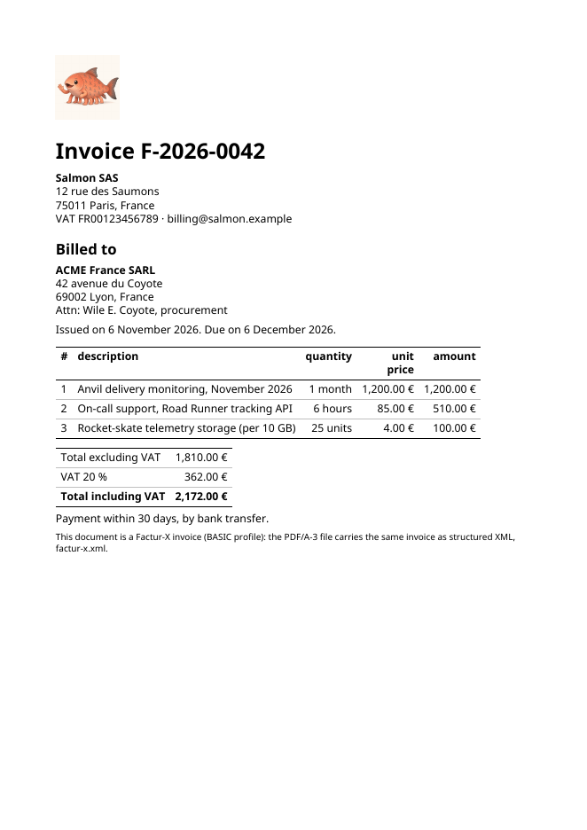

# Example: a Factur-X invoice

Salmon SAS bills ACME France SARL for a (fictional) ACME monitoring
service: a commercial invoice (`typeCode` 380, UNTDID 1001; `typeName` is
the heading). `invoice.tramaj` lays out the page and `factur-x.tramaj` writes the
same invoice as Cross Industry Invoice XML (Factur-X BASIC profile), both
from one context, `invoice.json`. The PDF is PDF/A-3b, with the XML
attached as `factur-x.xml` and the Factur-X XMP properties.



Regenerate, from the `tramaj-hpdf` directory (the bundled Noto Sans fonts
are embedded; needs colord's sRGB profile,
`/usr/share/color/icc/colord/sRGB.icc`, CC0-1.0; `--icc` points elsewhere):

```
cabal run tramaj-hpdf -- \
  --title "Invoice F-2026-0042" --author "Salmon SAS" \
  --factur-x examples/invoice/factur-x.tramaj --xml-out examples/invoice/factur-x.xml \
  examples/invoice/invoice.tramaj examples/invoice/invoice.json examples/invoice/invoice.pdf
pdftoppm -png -r 80 -singlefile examples/invoice/invoice.pdf examples/invoice/invoice-page1
```

`pdfdetach -list invoice.pdf` shows the attachment. The amounts in the
context are already computed (line totals, VAT, totals); the templates only
format them (`format-number`). The attachment's `/CreationDate` and
`/ModDate` are the invoice's issue date, read from the XML, so the output
is the same on every run.

Not yet checked by a validator: run veraPDF (PDF/A-3b) and Mustang
(Factur-X) on `invoice.pdf`:

```
verapdf --flavour 3b invoice.pdf
java -jar Mustang-CLI.jar --action validate --source invoice.pdf
```
