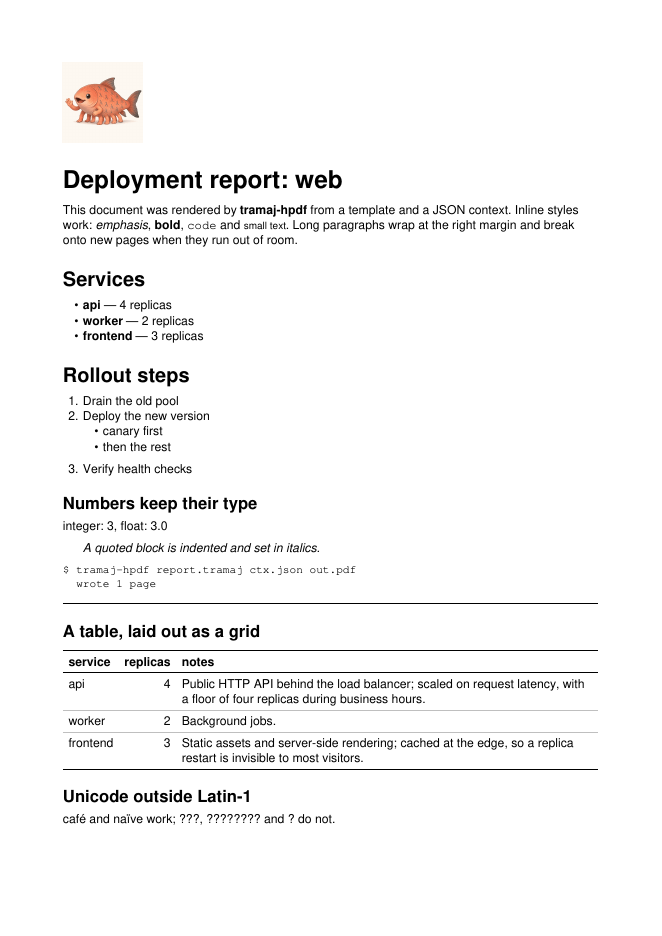

# Example: a deployment report

`report.tramaj` rendered against `report.json` into `report.pdf` (one A4
page). It shows headings, inline styles, nested lists, a quote, `pre`, a
rule, a table with a wrapped column, a PNG image (`logo001.png`, 300px) and
what happens to characters outside Latin-1.



Regenerate the PDF and the preview, from the `tramaj-hpdf` directory:

```
cabal run tramaj-hpdf -- examples/report/report.tramaj examples/report/report.json examples/report/report.pdf
pdftoppm -png -r 80 -singlefile examples/report/report.pdf examples/report/report-page1
```
